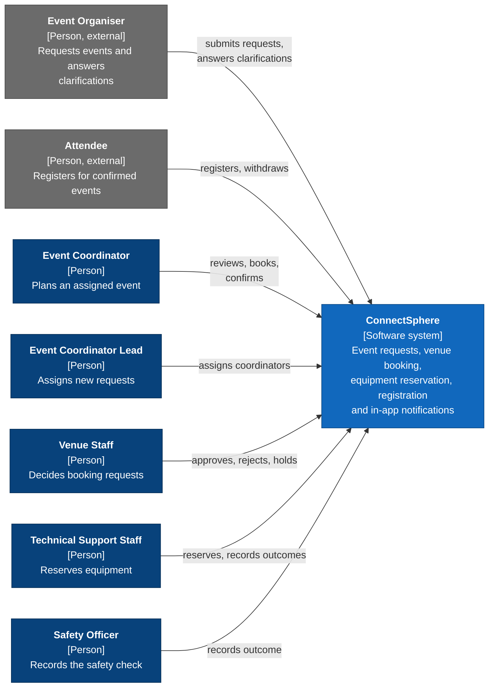

# C4 level 1: system context

Who uses ConnectSphere, and how they interact with it. Roles come from the `Role` enum in
`backend/app/modules/auth/permissions.py`. Notifications are in-app only, so there is no email or SMS
system on this diagram. Only people appear here; delivery tooling is left out.

The C4 diagrams in this folder are drawn as Mermaid flowcharts that follow C4 conventions (person, system,
container and component boxes, with the technology in square brackets). Mermaid's own `C4Context` syntax is
experimental and lays out poorly, so it is not used.

