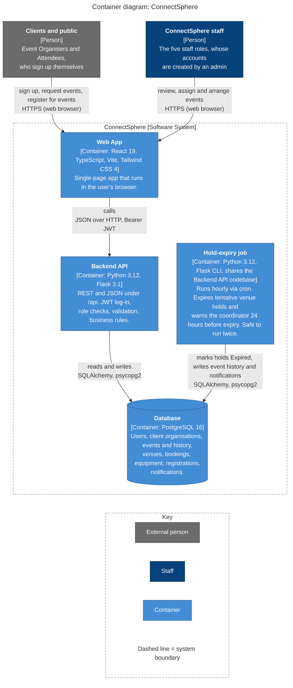

# C4 level 2: containers

The separately running or deployable pieces. Versions are from `frontend/package.json`,
`backend/requirements.txt` and `docker-compose.yml`.

**Notes**

- Staff accounts are created by an admin with the `flask create-staff-user` command, not through
  sign-up (ADR-0023). There is no separate Administrator or CLI container on the diagram.
- `docker-compose.yml` runs `postgres:16-alpine` and the backend on `python:3.12-slim` for local development.
- Alembic migrations run up to `0048_create_revoked_tokens_table` (as of 31 Oct 2026).
- The cron schedule is `.github/workflows/expire-holds.yml` (minute 7 of every hour, UTC). It stops after
  its first step until a `DATABASE_URL` repository secret exists, so the job does not yet run against a
  deployed database.
