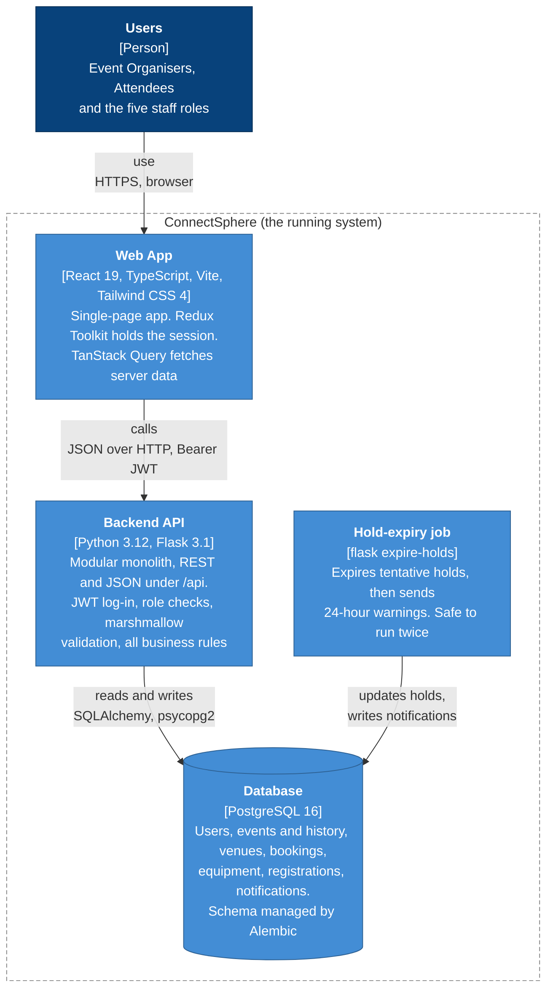

# C4 level 2: containers

The separately running or deployable pieces. Versions are from `frontend/package.json`,
`backend/requirements.txt` and `docker-compose.yml`.

**Notes**

- The backend also ships a `flask create-staff-user` command. Staff accounts are created that way, not
  through sign-up (ADR-0023).
- `docker-compose.yml` runs `postgres:16-alpine` and the backend on `python:3.12-slim` for local development.
- Alembic migrations run up to `0045_add_venue_booking_released` (as of 25 Oct 2026).
