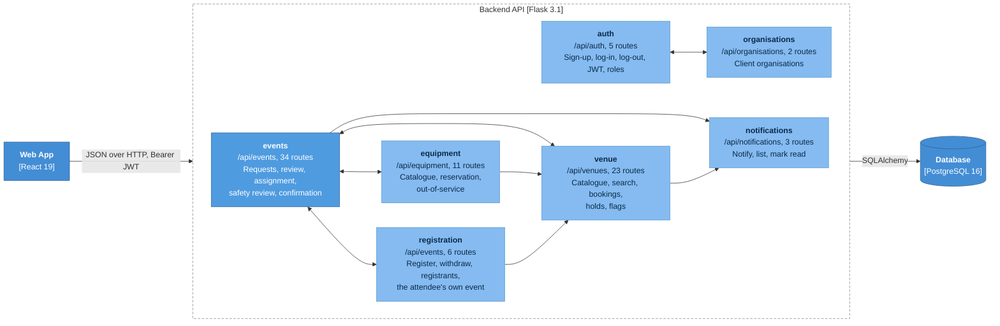
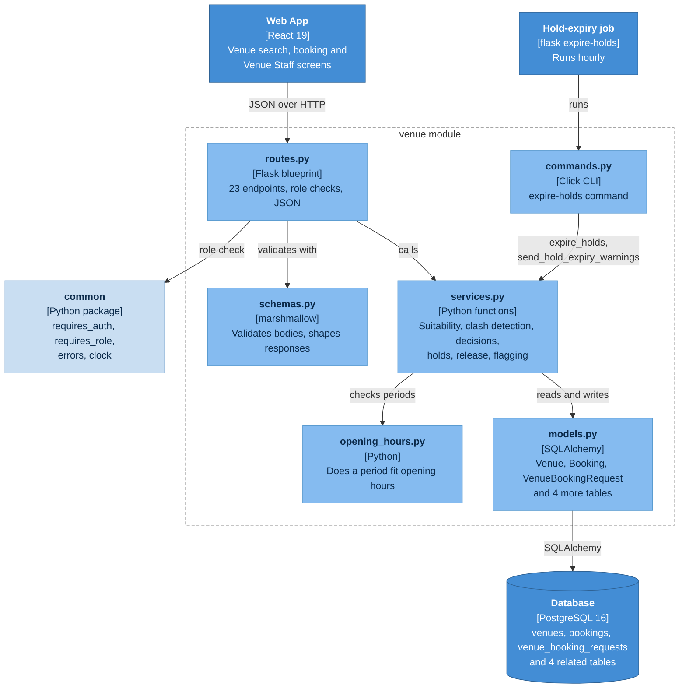

# C4 level 3: components of the Backend API

## 3a. Modules and how they depend on each other

Each folder under `backend/app/modules/` is one Flask blueprint with its own routes, schemas, services
and models. Arrows between modules are real imports found in the code; a two-headed arrow means each module
imports the other. Endpoint counts are the `@bp.get/post/patch/put/delete` routes in each `routes.py`.

**What the arrows say about the design**

- `events` is the hub: `venue`, `equipment` and `registration` all depend on it, and it calls back into each of
  them and into `notifications`. `organisations` only talks to `auth`.
- The pairs `events` and `venue`, `events` and `equipment`, `events` and `registration` import each other.
  The code resolves this with function-local imports and marks them `# circular at import time`.
  It works, but it is the main place a change in one module can break another.
- Every module also uses the shared `common` package (role decorators, error types, business-time clock,
  validation) and `auth` for roles and tokens. Those arrows are left off to keep the picture readable.

## 3b. Inside one module (venue as the example)

Every module has the same layering. A request enters through `routes.py`, is checked by a marshmallow
schema, runs through a service function that holds the business rules, and touches the database through
the models. Only `auth` and `venue` also have a `commands.py`.

