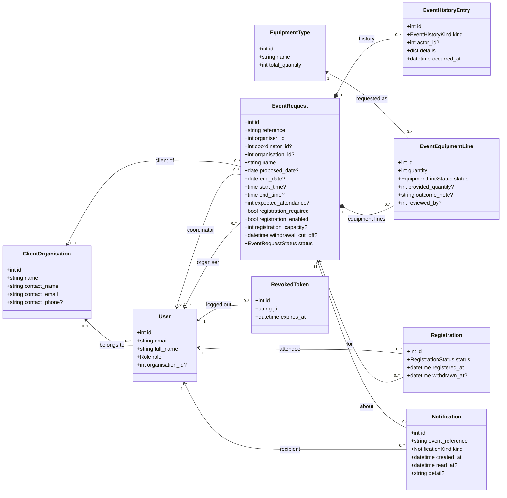
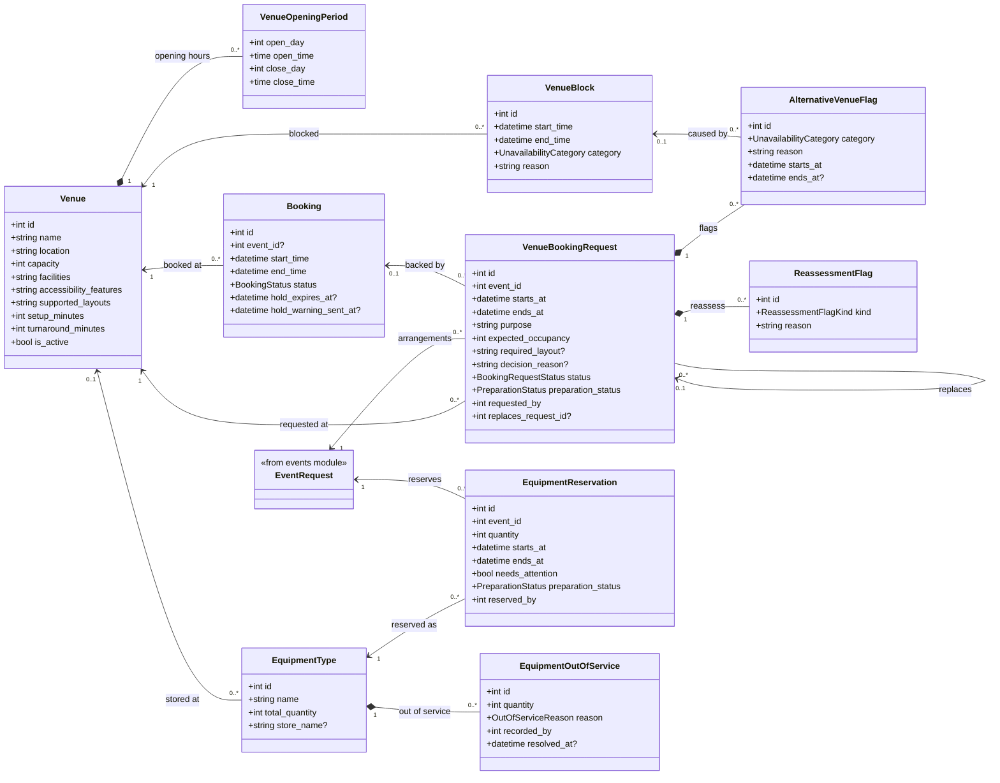

# UML class diagrams: domain model

Built from the SQLAlchemy models in `backend/app/modules/*/models.py`. Attributes are the mapped columns.
The models have no behaviour of their own: the rules live in each module's `services.py`, so the boxes show
data only. `?` means the column can be null.

## 4a. Event planning, people and registration

**Enumerations used above**

| Enum | Values |
|---|---|
| `Role` | event_organiser, attendee, event_coordinator, event_coordinator_lead, venue_staff, technical_support_staff, safety_officer |
| `EventRequestStatus` | draft, submitted, under_review, awaiting_clarification, approved, safety_review, confirmed, completed, cancelled, rejected |
| `EquipmentLineStatus` | requested, fulfilled, partially_fulfilled, unavailable |
| `RegistrationStatus` | registered, withdrawn |

`EventHistoryKind` (23 kinds) and `NotificationKind` (30 kinds) are enumerations too. They are left off the
diagram because their value lists are long. See `events/models.py` and `notifications/models.py`.

## 4b. Venues, bookings and equipment

**Enumerations used above**

| Enum | Values |
|---|---|
| `BookingRequestStatus` | pending, on_hold, approved, rejected, conflicting, withdrawn, expired, released |
| `BookingStatus` | tentative, confirmed, conflicting, cancelled |
| `PreparationStatus` | not_started, in_progress, ready |

`UnavailabilityCategory`, `ReassessmentFlagKind` and `OutOfServiceReason` are also enums. See `venue/models.py` and
`equipment/models.py` for their values.

`Booking.event_id` is a plain integer with no foreign key, so a booking is tied to its event only by
convention. The request-to-booking link (`booking_id`) is set only for holds and bookings a hold turned into.
