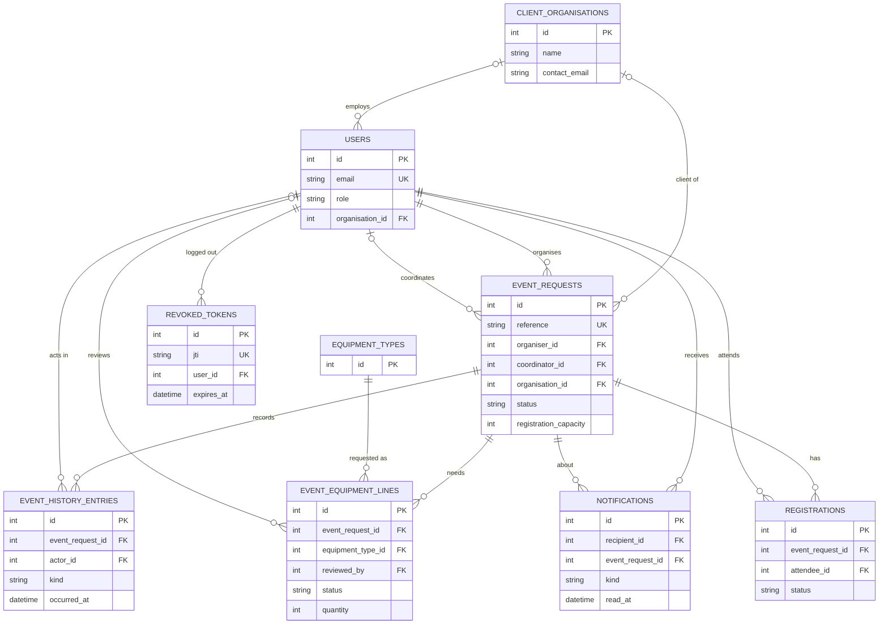
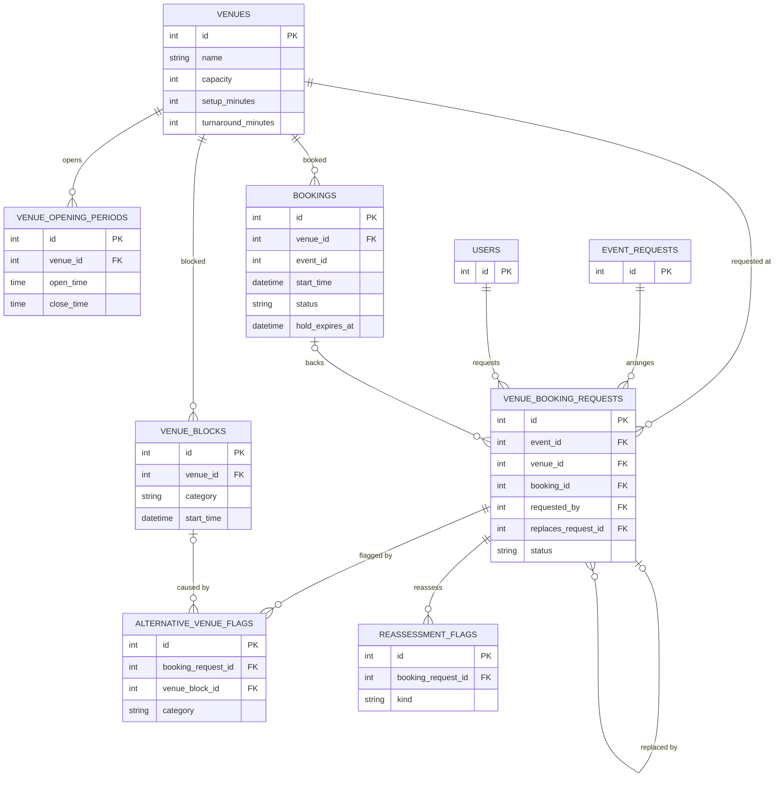
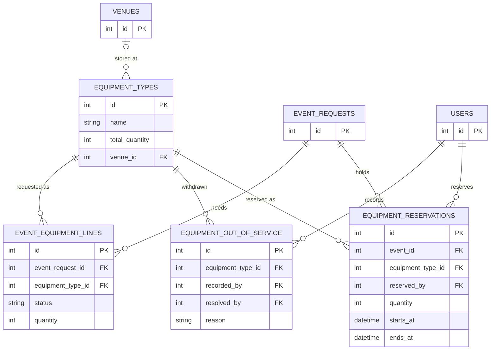

# Entity-relationship diagrams

The 18 tables created by the Alembic migrations (latest `0048`), split into three views so each stays readable.
Only keys and the columns that explain a relationship are shown. A table shown with just its key is a stub: it
appears in full in another view. `bookings.event_id` has no foreign key, so it is a plain column with no line.

## 5a. People, events, registration and notifications

`revoked_tokens` holds one row per access token logged out before it expired (SCRUM-89, ADR-0110).

## 5b. Venues and bookings

## 5c. Equipment

An event's equipment *line* (what the coordinator asked for) and its *reservation* (what Technical Support set
aside for a time window) are separate tables. A reservation reduces the quantity free for overlapping events.
