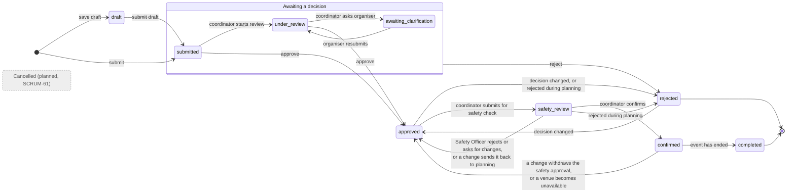
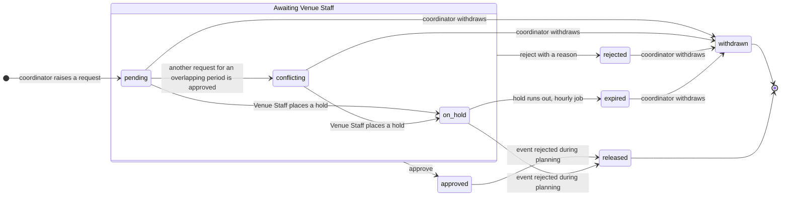

# UML state diagrams

Transitions are taken from the service functions that set each status, not from the stories. Grey, dashed
states are planned in Jira but have no code on `main` yet.

## 6a. Event request lifecycle (`EventRequestStatus`)

- A request can be decided only while it is submitted, under review or awaiting clarification. One awaiting
  clarification can be rejected but not approved until the organiser answers (ADR-0029).
- An approved or rejected request can be decided again, with a reason, until the event has an equipment request
  or a venue arrangement (ADR-0028). A rejection during planning is final (ADR-0106).
- Back to approved from safety review or confirmed: a Safety Officer's rejection or request for changes
  (ADR-0047), a change that withdraws the safety approval (ADR-0087) or leaves an arrangement unsettled
  (ADR-0107), and, from confirmed only, a venue becoming unavailable (SCRUM-92, ADR-0053).
- Confirming needs the Safety Officer's approval, every active venue arrangement approved and every equipment
  line given an outcome (ADR-0051).
- `cancelled` exists in the enum and counts as a closed status, but nothing moves an event there yet. That is
  SCRUM-61 in Sprint 4.
- Rejecting during planning also releases the event's venue arrangements and equipment reservations (see the
  sequence diagram 7d).

## 6b. Venue booking request lifecycle (`BookingRequestStatus`)

- Approving a request books the venue and marks every other pending request that clashes with it
  `conflicting`. Setup and turnaround time count towards the clash (ADR-0011, ADR-0045).
- A hold has an expiry that Venue Staff set. The job warns the coordinator 24 hours before and expires the
  hold when the time passes (ADR-0052).
- A rejected, expired or conflicting request stays on the event until the coordinator withdraws it. A
  rejected arrangement still blocks confirmation (see `docs/sprint-3-open-decisions.md`, section 1.1).
