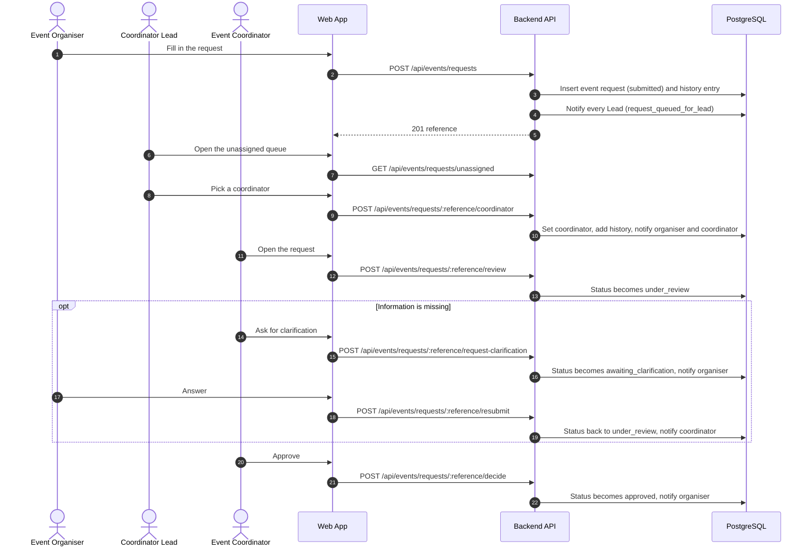
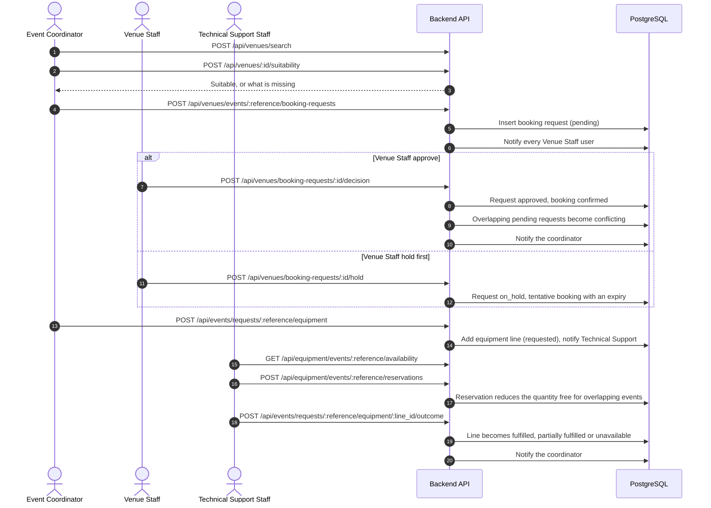
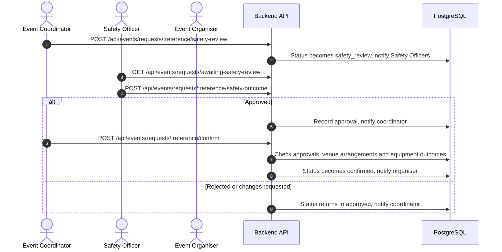
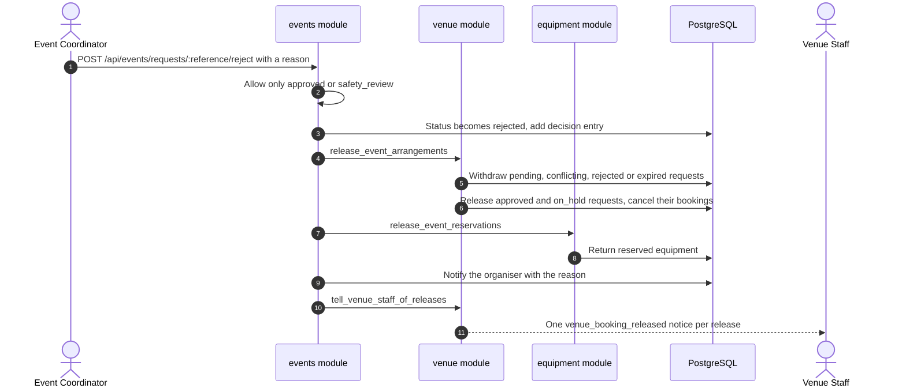
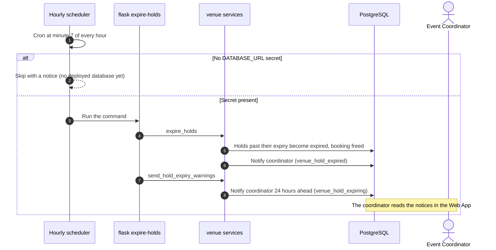

# UML sequence diagrams

Routes are the real ones in `backend/app/modules/*/routes.py`. Every call goes from the Web App to the Backend
API with a Bearer JWT. The API writes to PostgreSQL and also writes in-app notifications there.

## 7a. From request to approval

## 7b. Venue booking and equipment

## 7c. Safety check and confirmation

## 7d. Rejecting an event during planning releases its arrangements

## 7e. Hourly hold expiry

